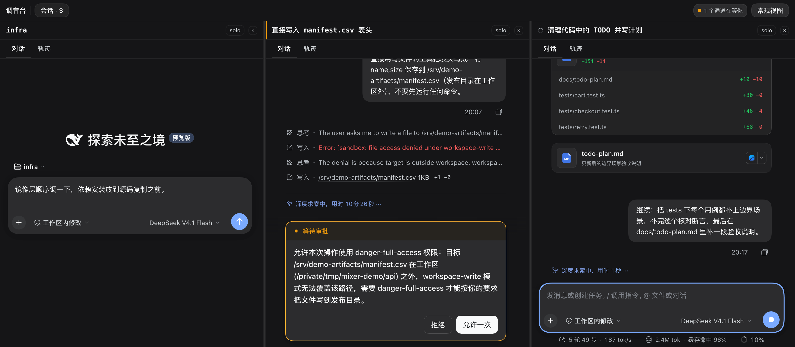
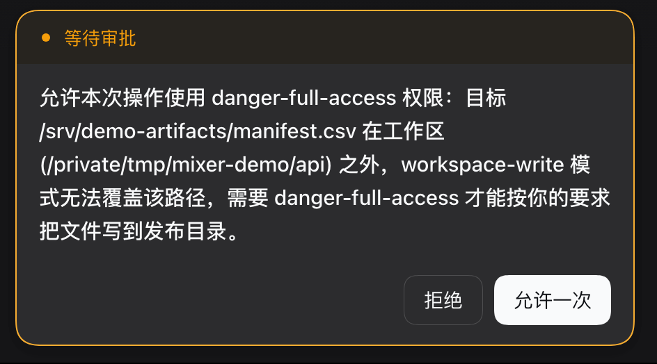
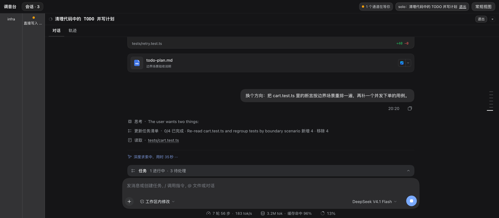

<div align="center">
  
  <h1>dsh-mixer · 调音台</h1>
  <p><b>把多个 DSH 会话并排摆到一屏。谁在等你，一眼就看见。</b></p>
  <p>
    
    
    
    
  </p>
</div>



> 同一屏里三种状态并存：一个是空对话，一个是正在跑（转圈 + 工具调用），一个卡在**等待审批**（审批卡就在那一格里，顶栏同步计数）。

> 截图由真实 DSH 宿主驱动，工作区与会话均为虚构演示数据。

---

## 为什么需要它

并行推进三四个需求时，你一次只能看一个会话。切走的那几格如果卡在**等待审批**、**等待计划确认**、或者**有一个问题要你回答**，它们就安静地空等 —— 你不知道，机器也停在那儿。

调音台把这件事摊平：多个会话横着摆开，每个一格，等待你的那一格会亮。

## 它做什么

- **一屏多路，真并排** —— 每格是一个真实会话：完整对话记录 + 官方输入框，草稿互不干扰。不是缩略图，也不是只读快照。
- **亮灯** —— 卡在审批 / 计划确认 / 提问的通道，头部亮一条琥珀竖条；顶栏汇总成「N 个通道在等你」，点一下全部放回。状态点与左侧会话行**同源同判据**：等待、执行中、子代理运行中、已完成未读，一格一格对得上。
- **solo** —— 临时只看一个通道，其余压成 64px 窄条：还在跑、还亮灯，只是不抢注意力。退出后宽度原样回来。
- **归档可撤销** —— 在调音台里归档一个会话，顶栏会出现 6 秒的「已归档「…」撤销」，撤销后通道回到原位置、原宽度。
- **跳转快捷键** —— `Cmd/Ctrl + Alt + 1..9` 跳第 N 个通道，`]` / `[` 上下切换，`S` solo。走 DSH 自己的快捷键服务，可以在设置里改键。
- **排布随你** —— 拖通道头部排序（虚影是整格），拖格间分界线调宽，宽度和通道集合刷新后仍在。

## 安装

需要 **DSH 0.2.1 或更新的 Web 端**（`dsh web`；本版在 `0.2.1-rc.2` 上验证通过）。

```bash
# 一行装好（Web profile）
dsh plugin --profile web add github:dtdths/dsh-mixer#v1.5.0
```

> `dsh` 不在 PATH 里（从源码 checkout 跑）就用 `pnpm dsh plugin --profile web add …`，见下面折叠。

然后重启 DSH，并在浏览器里**硬刷新**一次（`Cmd/Ctrl + Shift + R` —— 插件改动必须走冷启动，热重载会骗人）：

```bash
dsh web            # 或你平时启动 DSH 的方式
```

看到会话头部多出一个 **调音台** 按钮，就装好了；也可以在输入框里敲 `/mixer` 进入。

<details>
<summary>从源码 checkout 运行 / 装在 Desktop / 完全离线</summary>

**从 DSH 源码 checkout 运行**（仓库根目录）：

```bash
pnpm dsh plugin --profile web add github:dtdths/dsh-mixer#v1.5.0
```

**装在 Desktop 版**（先完整退出 Desktop，否则 profile 被占用）：

```bash
dsh plugin --profile desktop add github:dtdths/dsh-mixer#v1.5.0
```

**改代码 / 开发调试**（`link:` 本地目录，改完刷新即生效）：

```bash
dsh plugin --profile web add /绝对路径/dsh-mixer
```

**完全离线**（打包成 tgz 传过去）：

```bash
npm pack --cache /tmp/npm-cache        # 产出 dsh-mixer-1.5.0.tgz
dsh plugin --profile web add /绝对路径/dsh-mixer-1.5.0.tgz
```

**不想敲命令**：如果你的 DSH 里有 `plugin_manager` 工具，直接在会话里说一句「安装插件 `github:dtdths/dsh-mixer#v1.5.0`」即可。

> 装过早期原型 `dsh-mixer-spike` 的话请先卸掉 —— 它和正式版会抢同一个视图入口。
</details>

## 上手

**1. 加通道** —— 顶栏的 `会话` 浮层里勾选会话，勾上即入、取消即出。浮层左列每个工作区行 hover 会出 `＋会话`，点它就在那个工作区新建一个会话，并直接成为第 0 个通道。

**2. 等你的通道会亮** —— 某个通道的会话在等你处理时，头部左侧出现琥珀竖条，顶栏同步累加计数；点顶栏的汇总条可以把移出的通道全部放回。



*通道里的审批卡：拒绝 / 允许一次就在这一格完成，不用切走。*

**3. solo 一下** —— 通道头部的 `solo`、顶栏的 `solo：… 退出`、或 `Cmd/Ctrl + Alt + S`，三处进出。其余通道压成窄条，状态点仍然准确。



**4. 排布** —— 拖通道头部换位置；拖格与格之间的分界线调宽（单格最小 380px，超宽就横向滚动）；`×` 把通道移出屏幕，顶栏可再放回。

**5. 回常规视图** —— 顶栏「常规视图」，或点左侧栏的会话行。侧栏恢复原状，原来那格的滚动位置与草稿都还在。

## 快捷键

| 动作 | 默认键位 |
| --- | --- |
| 跳到第 1–9 个通道 | `Cmd/Ctrl + Alt + 1..9` |
| 下一个 / 上一个通道 | `Cmd/Ctrl + Alt + ]` / `[` |
| solo 光标所在通道 | `Cmd/Ctrl + Alt + S` |

全部注册在 DSH 的快捷键设置里，可以改成你自己的。跳过去时光标落在该格草稿的**末尾**，接着写就行。

## 设计上的取舍

- **左侧栏折成 56px 轨道** —— 宿主没有「完全隐藏」的选项，接管侧栏又会连带弄丢设置入口，所以左边永远留一条窄轨。
- **单格最小 380px** —— 不够宽就横向滚动，而不是把每格挤到没法用。
- **solo 与「移出」不持久化** —— 它们属于「这一次坐着」的临时状态，刷新即回到并排；**通道集合与每格宽度是持久化的**。
- **归档撤销只留 6 秒** —— 与侧栏归档 toast 同一个窗口，不长不短。
- **主题跟随宿主** —— 浅色/深色都用宿主 alias token，不另造一套颜色。
- **纯客户端** —— Host half 保持为空，全部逻辑在视图层：不发网络请求、不写宿主的 `mainView`、不碰模型配置。

## 开发与自检

```bash
npm run check                              # 语法 + 96 个用例 + 冷启动守卫
DSH_REPO=/另一个/DSH/checkout npm run check  # 换宿主重验：契约漂移会指到具体断言
```

`npm run check` 里的**冷启动守卫**不是可选项：本插件踩过「服务边写错 → 整页启动失败、而热重载看起来一切正常」的坑，所以任何 `apply()` / `inject` 改动都要走这条。

客户端全部逻辑在单文件 [`client.js`](client.js)（`React.createElement`，非 JSX）；判断逻辑抽成纯函数并经 `__test` 暴露给 `tests/`。换宿主时最该读的是 [`tests/host-contract.test.mjs`](tests/host-contract.test.mjs) —— 它把插件依赖的每一条宿主契约都钉成了会失败的断言。

## 文档

| 想知道什么 | 看哪里 |
| --- | --- |
| 需求、决策、验收判据、实现红线、内部缝 | [`docs/spec.md`](docs/spec.md)（**§11 是实现状态与缝表**） |
| 三条不改的架构决策 | [`docs/adr/`](docs/adr/) |
| 插件开发踩过的坑（服务边、冷启动、拖拽、键位校验） | [`docs/plugin-gotchas.md`](docs/plugin-gotchas.md) |
| 术语 | [`CONTEXT.md`](CONTEXT.md)、[`docs/naming.md`](docs/naming.md) |
| README 里的截图怎么来的（宿主版本、复现步骤、演示数据说明） | [`docs/assets/PROVENANCE.md`](docs/assets/PROVENANCE.md) |
| 待办增强 | [issue #12](https://github.com/dtdths/dsh-mixer/issues/12) |

报 bug、提需求都走 [GitHub issues](https://github.com/dtdths/dsh-mixer/issues)（带一张截图最好）。

<details>
<summary>目录结构</summary>

```
dsh-mixer/
├── package.json          # bundle 清单 + dsh.client.external / inject
├── cordis.patch.yml      # 插入行 id=dsh-mixer
├── index.js              # Host half（保持为空）
├── client.js             # Client half：全部 UI 与状态，单文件
├── boot-check.mjs        # 冷启动守卫（真实 Cordis Context + 对照项）
├── tests/                # 纯函数缝 / 真 React 静态渲染 / jsdom 交互 / 宿主契约
├── locale/{en,zh}.json   # meta.title / meta.description
├── icon.svg              # 三路推子，其中一路亮灯
├── docs/                 # spec / ADR / 踩坑 / 命名 / 调研
│   └── assets/           # README 截图 + 出处记录
└── LICENSE
```
</details>

## English

**dsh-mixer** is a mixer-style multi-session view for [DeepSeek Harness](https://github.com/deepseek-ai/deepseek-harness): several independent conversations side by side, each with its own history and composer, with the channels blocked on an approval or a question lit up — so nothing waits for you silently.

```bash
dsh plugin --profile web add github:dtdths/dsh-mixer#v1.5.0
```

Restart DSH, hard-refresh the page, then press the **Mixer** button in the session header (or type `/mixer`). Requires DSH 0.2.1+ web. Screenshots use fabricated demo data.

## License

MIT，见 [LICENSE](LICENSE)。
